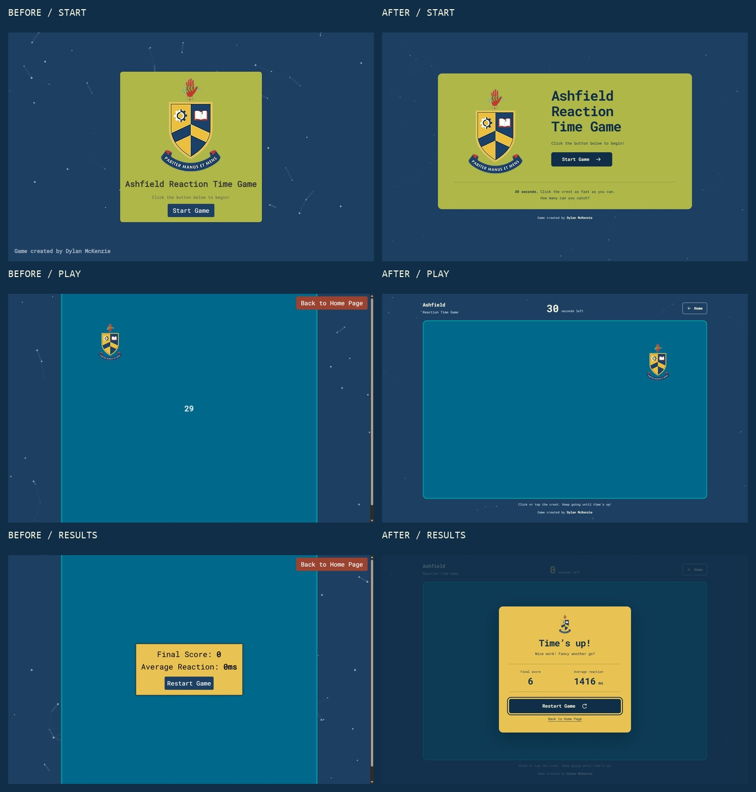
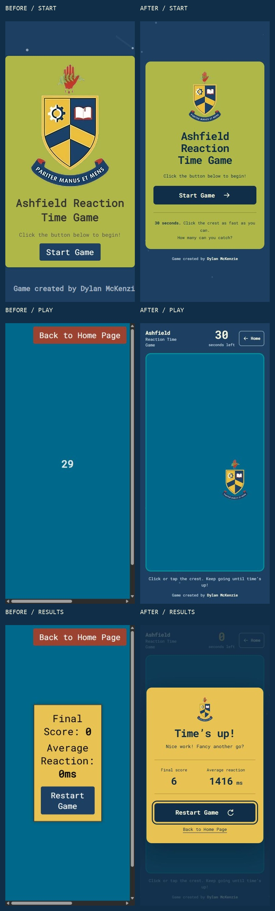

# ABHS game: before and after

The refinement keeps the original school crest as the target, the navy, teal,
yellow-green and gold colours, Roboto Mono, particles.js, Dylan McKenzie's credit,
and the same start → 30-second round → results → restart/home journey.

The start panel has a clearer composition and primary action. The play field fits
the viewport, keeps the entire crest inside its border after spawning or resizing,
and separates the timer and navigation from gameplay. Results use a gold dialog
with labelled statistics, keyboard focus management and a prominent restart action.
Short landscape screens get a compact results layout.

Targets appear and move immediately, with no entrance or movement animation.
Pointer presses score immediately; compatibility clicks cannot count twice.
The clock uses an elapsed-time deadline, and late input cannot score. The target
is disabled and hidden when the round ends. A round with no hits shows an em dash
for average reaction time instead of suggesting a zero-millisecond reaction.

Particles remain animated at a calmer pace. They are decorative and cannot
intercept input. Reduced motion makes the particles static and removes the
results entrance and button transitions, including when the preference changes.

## Comparison captures

Original screens were captured before editing. Pairs use the same viewport and
state: desktop at 1440 × 900 and mobile at 390 × 844. Contact sheets scale exported
browser images into equal frames; the original overflowing game has visible
scrollbars. Target positions, scores and particle positions vary between rounds.

## Verification

- Completed real 30-second rounds in Chromium, with pointer and keyboard target
  activation. A five-pointer-hit plus one-keyboard-hit round ended with score 6.
- Verified restart by mouse and keyboard, fresh 30-second countdowns, return home
  from results, and Home navigation during gameplay.
- Inspected start, gameplay and results at desktop and mobile sizes; also checked
  320 × 568, tablet 768 × 1024, and landscape 844 × 390 layouts. The smallest start
  screen can scroll naturally; gameplay and results fit the checked viewports.
- Checked target bounds after repeated catches and resizing. At 390 × 844, the
  target's hit area is approximately 79 × 124 CSS pixels.
- Checked keyboard focus, readable no-hit results,
  decorative particle canvases, and browser logs with no warnings or errors.
- Main text contrast ranges from 6.46:1 (navy on yellow-green) to 12.52:1
  (light text on buttons). Secondary text on navy is 7.05:1.
- Eight automated checks cover scoring, reaction averages, the exact deadline,
  duplicate input, post-round input, resize bounds, restart, background timer
  recovery, and particle motion preferences. Run `node --test tests/*.test.cjs`.
- Ran the Impeccable detector once. Addressed small mobile text and the shadow
  colour. Its Roboto font warning is intentionally retained to honour the brief.

Mobile checks used resized Chromium viewports and automated input-handler tests;
physical touch devices and Safari were not tested. Motion preferences were tested
in the automated checks; an OS-level preference change was not exercised manually.
